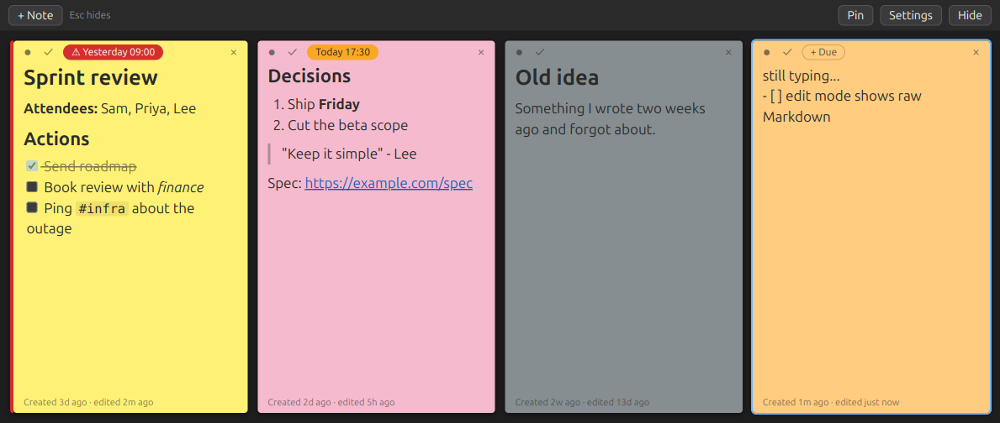
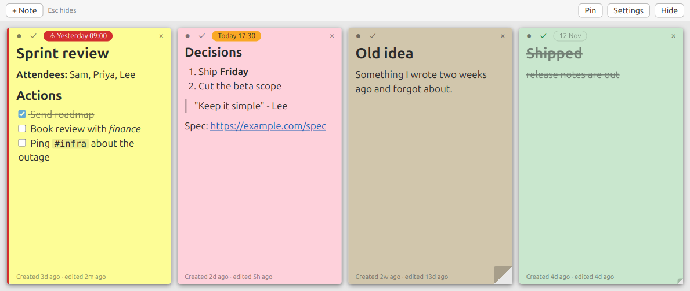
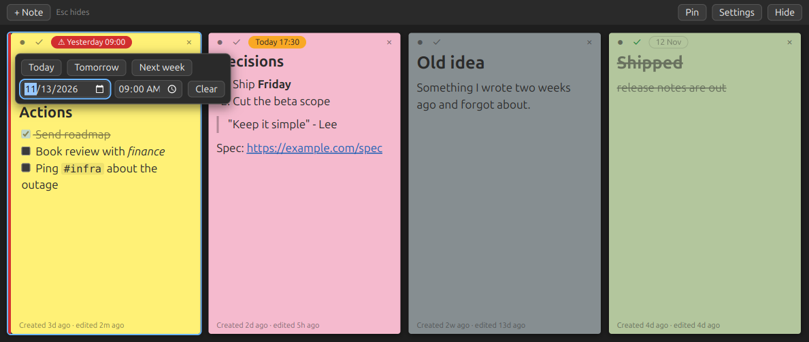
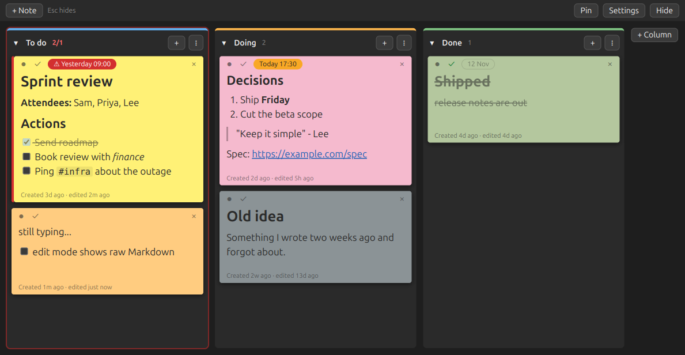
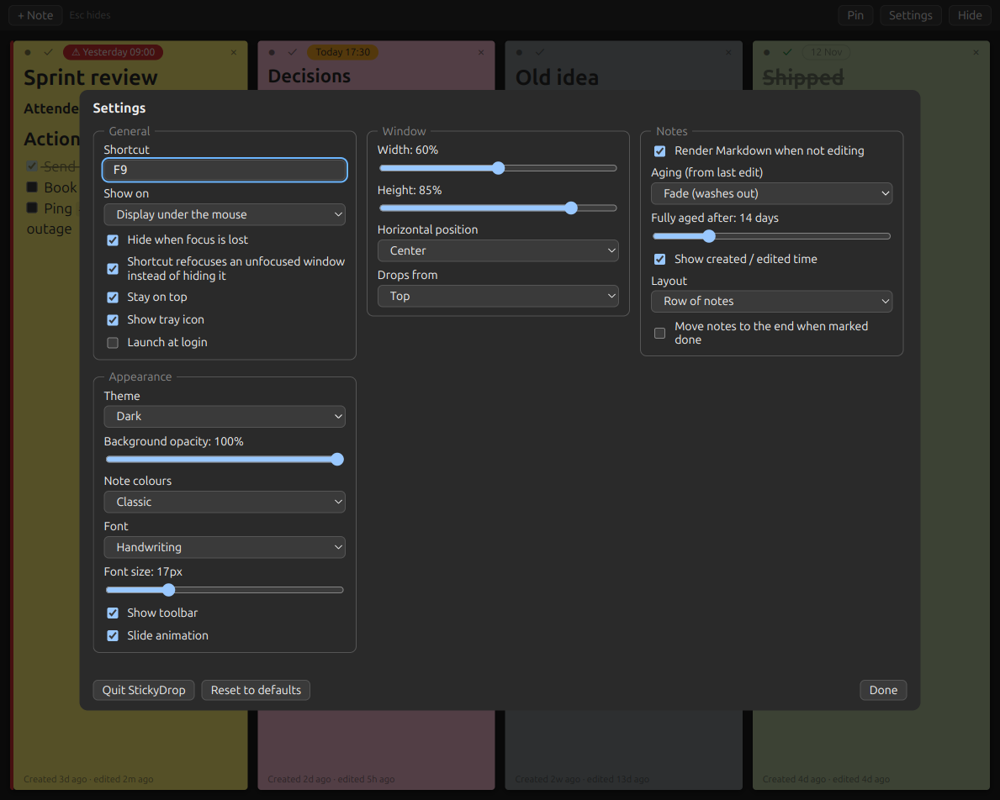

# StickyDrop

**Guake-style drop-down post-it notes** for Ubuntu, macOS and Windows.

Press a key and a row of sticky notes drops from the top of your screen. Jot something down, press `Esc`
(or just click back into your meeting) and it's gone, with no app switching and no lost context. Built for
virtual meetings: quick notes, action items with due dates, and a scratchpad that is always one keypress away.



*Dark theme, Classic palette. From the left: a note with an overdue badge and ticked tasks, one due today,
one that has sat untouched for two weeks (faded), and one being edited (raw Markdown).*

## Contents
- [Features](#features)
- [Screenshots](#screenshots)
- [Install and run](#install-and-run)
- [Using it](#using-it)
- [Settings reference](#settings-reference)
- [Linux on Wayland](#linux-on-wayland-ubuntus-default)
- [Your data](#your-data-and-privacy)
- [Platform status](#platform-status)
- [Development](#development)
- [Known limitations](#known-limitations)

## Features

**Drop-down behaviour (the Guake part)**
- Global hotkey toggles the window: `F9` by default (`Ctrl+Alt+N` on macOS, where F9 is a system key); change it in Settings.
- Opens on the display under your mouse (or the primary / a specific display), full width or any size from 20% of the screen.
- **Drag the grip bar on the window's inner edge** to resize it on the fly (double-click it to reset); the height is remembered.
- Drops from the top or the bottom, aligned left, centre or right, with an optional slide animation.
- Hides when focus is lost, so clicking back into your meeting dismisses it. **Pin** keeps it open.
- If it is open but unfocused, the hotkey *refocuses* it instead of hiding it (as Guake's "refocus" option does).
- Stays on top of other windows (set to appear above full-screen apps on macOS, which is untested), appears on every workspace, lives in the tray, never in the taskbar.
- Single instance: launching it again just shows the window. `stickydrop --toggle` toggles a running instance, which is how you bind a system shortcut on Wayland.

**Notes**
- Any number of notes in a row; each autosaves as you type. Five colours per palette, four palettes.
- **Markdown**: notes render when you aren't editing them, and clicking one brings the text back.
  Headings, **bold**, *italic*, ~~strikethrough~~, `inline code` and fenced code blocks, nested and numbered lists,
  quotes, rules, links (open in your browser). Task lists (`- [ ]`) render as checkboxes you can tick without entering edit mode.
- Delete has a 6-second **undo**; there is always at least one note.

**Due dates and done**
- Optional due date and time per note, with quick picks for Today / Tomorrow / Next week.
- A badge shows the state: **amber** when due today or within 24 hours, **red with a red edge** when overdue.
- A ✓ toggle marks a note done: dimmed and struck through, never flagged overdue. Optionally it moves to the end.
- The tray menu summarises what is overdue or due today ("2 overdue, 1 due today") and lists those notes.

**Kanban board (optional)**
- Settings → Notes → **Layout: Kanban board** turns the row of notes into columns. It is the same notes, so you can switch back and forth freely; the default stays a plain row.
- Starts with *To do / Doing / Done*. Click a column name to rename it, **+ Column** adds one (up to 8), **×** deletes one (its notes move to the first column), **+** adds a note to that column.
- Drag a note by its header to move it between or within columns, or use `Alt+←/→` (change column) and `Alt+↑/↓` (reorder) on the focused note.
- Each column's **⋮** menu sets a colour, an optional note limit (a soft warning: the count turns red, nothing is blocked) and delete. **▾** collapses a column to a thin strip. Drag a column header to reorder columns.
- Moving a note into the done column marks it done, moving it out clears that; the ✓ button does the same move. Moving is not an edit, so it doesn't reset aging.

**Aging**
- Notes visually age with the time since their *last edit*: **Fade** (the paper washes out) or **Vintage**
  (it yellows and a corner curls). Editing a note, ticking a task or changing its due date rejuvenates it.
- You choose how many days until fully aged (1–60). Overdue is a separate signal: its badge and edge never fade.
- Every note shows "Created 3d ago · edited 2h ago" (exact times on hover); this can be turned off.

**Customisation** (Settings, `Ctrl/Cmd+,`; modelled on Guake's preferences)
- Dark, light or follow-system theme; background opacity; four note palettes; four fonts and a size slider; hide the toolbar.
- Window width, height, horizontal position and drop direction; which display; stay-on-top; tray icon; launch at login.
- **Reset to defaults** (two clicks to confirm) restores everything except your notes.

## Screenshots

| | |
|---|---|
|  |  |
| **Light theme, Pastel palette, Vintage aging.** The old note yellows and curls; the done note is struck through; overdue stays red. | **Due date popover**: quick picks plus an exact date and optional time. |



*Kanban board layout: coloured columns, here with a note limit of 1 exceeded in To do.*



*Settings: General, Window, Notes and Appearance groups. Changes apply live.*

(Screenshots are regenerated from sample data with `node scripts/screenshots.js`.)

## Install and run

**Download:** grab the `.deb`, `.AppImage` (Linux), `.dmg` (macOS) or `.exe` (Windows) from the
[Releases page](https://github.com/karlbaillie/stickydrop/releases). Builds are unsigned (see below). Snap Store: `sudo snap install stickydrop` once published (see [RELEASING.md](RELEASING.md)).

**From source:** needs Node.js and npm (developed on Node 24). There are no runtime dependencies: Electron is bundled into the packaged app.

```bash
npm install
npm start            # run from source
```

Build installers for the OS you are on (output in `dist/`):

```bash
npm run dist         # Linux: .deb and .AppImage · macOS: .dmg · Windows: NSIS installer
sudo apt install ./dist/stickydrop_0.1.0_amd64.deb   # Ubuntu/Debian; the post-install step adds a `stickydrop` command
```

Notes:
- `npm start` passes `--no-sandbox` because Electron's sandbox helper isn't set up for a source checkout on recent
  Ubuntu. The `.deb` installs the helper properly; the AppImage disables the sandbox itself.
- If `npm install` finishes but Electron says it "failed to install correctly", run `node node_modules/electron/install.js`
  (or delete `node_modules/electron` and reinstall).
- `.github/workflows/build.yml` builds all three platforms on GitHub runners. Builds are not notarised or
  code-signed with a paid certificate. **macOS** (ad-hoc signed): the first launch is blocked; open System Settings →
  Privacy & Security → "Open Anyway", or run `xattr -dr com.apple.quarantine /Applications/StickyDrop.app`.
  The release build is arm64 (Apple Silicon) only for now. **Windows**: SmartScreen shows "More info → Run anyway".

## Using it

| Key | Action |
|---|---|
| `F9` (macOS `Ctrl+Alt+N`) | Show / hide / refocus the window (configurable) |
| `Ctrl/Cmd+N` | New note |
| `Ctrl/Cmd+,` | Settings |
| `Esc` | Close the due popover or settings if open, otherwise hide the window |
| `Alt+←/→` / `Alt+↑/↓` | Board layout: move the focused note to another column / reorder it |
| `Tab` | Move between notes and their controls |
| Click a rendered note | Edit it; it re-renders when focus leaves |

Each note's header has: a colour button (●), a done toggle (✓), a due badge, and delete (×). The toolbar has
**+ Note**, **Pin**, **Settings** and **Hide**. Right-click the tray icon for show/hide, the due summary and Quit.
Closing the window (Alt+F4) only hides it; quit from the tray menu or Settings.

Command line:

```bash
stickydrop --toggle    # show/hide the running instance (starts it if needed)
stickydrop             # a second launch simply shows the window
```

## Settings reference

| Group | Setting | Default | Notes |
|---|---|---|---|
| General | Shortcut | `F9` / `Ctrl+Alt+N` (macOS) | Click and press the new combination; plain letters are rejected |
| General | Show on | Display under the mouse | Or primary display, or a specific one |
| General | Hide when focus is lost | on | Pin overrides it for the session |
| General | Shortcut refocuses an unfocused window | on | Otherwise the shortcut always hides a visible window |
| General | Stay on top | on | |
| General | Show tray icon | on | |
| General | Launch at login | off | Linux: `~/.config/autostart`; macOS/Windows: login items |
| Window | Width / Height | 100% / 40% | 20–100% / 15–100% of the display's work area; height is also set by dragging the window edge |
| Window | Horizontal position | Center | Left, center or right (when narrower than 100%) |
| Window | Drops from | Top | Top or bottom |
| Notes | Render Markdown when not editing | on | Off = plain text boxes |
| Notes | Layout | Row of notes | Row or Kanban board; columns, colours and limits are kept in your data, not reset |
| Notes | Note width | 420 px | 260–800; the most a note stretches in the row layout |
| Notes | Aging | Fade | Off, Fade, or Vintage |
| Notes | Fully aged after | 14 days | 1–60 |
| Notes | Show created / edited time | on | |
| Notes | Move notes to the end when marked done | off | |
| Appearance | Theme | Dark | Dark, light, or follow system |
| Appearance | Background opacity | 100% | 30–100%; see [limitations](#known-limitations) |
| Appearance | Note colours | Classic | Classic, Pastel, Earth, Mono |
| Appearance | Font / Font size | Handwriting / 17 px | Handwriting, sans, serif, monospace; 12–32 px |
| Appearance | Show toolbar | on | Keyboard shortcuts still work when hidden |
| Appearance | Slide animation | on | |

## Linux on Wayland (Ubuntu's default)

The app runs under XWayland so it can position itself and stay on top. But Wayland only delivers global-hotkey
key presses to an X11 app while an X11 window has focus, so the built-in hotkey is unreliable there. (Guake has
the same limitation; its documented workaround is the same.) The fix is a **system shortcut** that runs
`stickydrop --toggle`.

GNOME: Settings → Keyboard → Keyboard Shortcuts → Custom Shortcuts → add `stickydrop --toggle` with the key you
want. Or from a terminal (note this replaces any custom shortcuts you already have, so add to the list instead if you do):

```bash
P=/org/gnome/settings-daemon/plugins/media-keys/custom-keybindings/stickydrop/
S=org.gnome.settings-daemon.plugins.media-keys.custom-keybinding:$P
gsettings set $S name 'StickyDrop'
gsettings set $S command 'stickydrop --toggle'      # or the full path to the AppImage / electron + project dir
gsettings set $S binding 'F9'
gsettings set org.gnome.settings-daemon.plugins.media-keys custom-keybindings "['$P']"
```

Starting the command also launches the app if it isn't running, so the shortcut works from a cold start.

## Your data and privacy

- Everything is stored locally in one JSON file: `~/.config/stickydrop/data.json` (Linux),
  `~/Library/Application Support/stickydrop/data.json` (macOS), `%APPDATA%\stickydrop\data.json` (Windows).
  It is plain, unencrypted text, so back it up or sync it like any file.
- Writes are atomic (temp file, then rename). If the file ever can't be parsed, it is moved aside as
  `data.json.corrupt-<time>` and never overwritten.
- No network access, accounts, telemetry or updates. Links in notes open only on click, only `http(s)`, in your browser.
- The window runs with context isolation, no Node integration and a `default-src 'self'` content-security policy.
  The Markdown renderer builds elements from text and never uses `innerHTML`, so a pasted `<script>` or ``
  is shown as plain text.

```json
{
  "settings": { "hotkey": "F9", "theme": "dark", "heightPct": 40, "...": "..." },
  "columns": [{ "id": "todo", "name": "To do", "color": 4, "limit": 3 }, { "id": "done", "name": "Done", "done": true }],
  "notes": [
    { "id": "k3j9x2ab", "text": "# Standup\n- [ ] send notes", "color": 0,
      "created": 1731571200000, "updated": 1731574800000, "due": "2026-11-14T17:00", "done": false, "col": "todo" }
  ]
}
```

## Platform status

| Platform | Status |
|---|---|
| Ubuntu 24.04+ on GNOME/Wayland (via XWayland) | **Developed and tested here**: end-to-end suite, packaging (`.deb`, AppImage), hotkey via `--toggle` |
| Linux on an X11 session | Expected to work, including the built-in global hotkey; not tested |
| macOS | **Untested.** Uses only cross-platform Electron APIs (full-screen overlay level, dock hidden, `Ctrl+Alt+N`) |
| Windows | **Untested.** Same caveat |

## Development

```
main.js          main process: window, tray, hotkey, settings schema + validation, persistence
preload.js       the small, explicit bridge between window and main
index.html       page shell · style.css: all styling, theming and aging effects
renderer.js      notes UI, due popover, settings form (generated from the schema main sends)
markdown.js      small safe Markdown → DOM renderer
timeutil.js      pure date / due / age / tray-summary helpers (shared by main and renderer)
test/            time.test.js (unit) · e2e.js (drives the real app with Playwright)
scripts/         screenshots.js (regenerates docs/*.png)
ROADMAP.md       ideas not built yet
```

All tasks are `just` recipes (`just` lists them); CI runs the same ones.

```bash
just test          # unit tests, then the end-to-end suite
just screenshots   # refresh docs/*.png
just dist          # build installers for this OS
```

- The end-to-end suite launches the real app against a temporary data directory (`STICKYDROP_DATA`), so it never
  touches your notes. It needs a display, and it needs `F9` to be free: **quit a running StickyDrop first.**
- It covers notes, undo, Markdown rendering and checkbox toggling, link handling, due dates, done, aging modes,
  timestamps, every settings group (including bad-value clamping and reset), window placement, `--toggle`,
  refocus, persistence across restarts and corrupt-file recovery.
- Adding a setting is one entry in `SCHEMA` in `main.js`; the settings form, validation, defaults and reset pick it up.

## Known limitations

- **Opacity below 100%** relies on the compositor honouring a transparent window. It is set and applied, but I haven't
  seen it blend with a desktop on any platform yet.
- **Wayland**: the in-app global hotkey is unreliable; use the `--toggle` system shortcut (above).
- **Touch screens**: board drag and drop is untested on touch hardware; use `Alt+Arrows` or the ✓ button there.
- **Markdown** has no tables, images or raw HTML (HTML is shown as text).
- **One set of notes**: no separate boards or tabs, search, labels, archive, reminders or sync yet. See [ROADMAP.md](ROADMAP.md).
- Notes that predate the date features were treated as created and edited at first launch after the upgrade.

## License

MIT, see [LICENSE](LICENSE).
