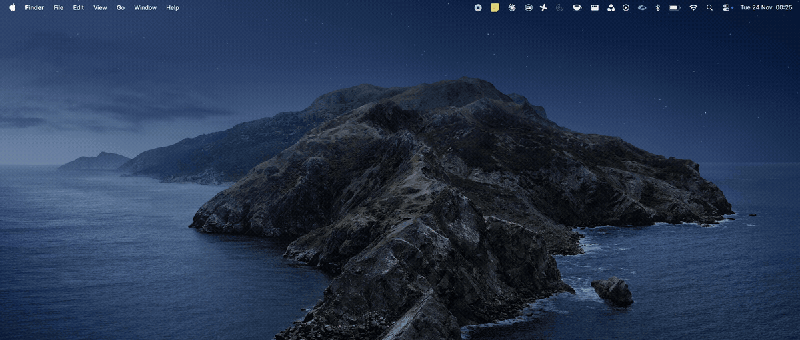
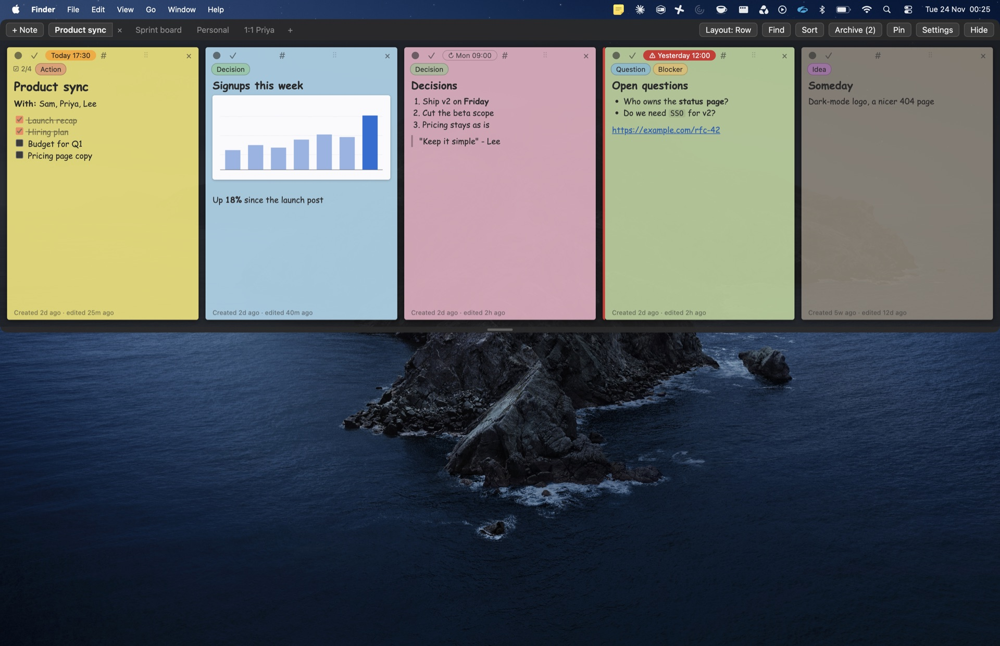
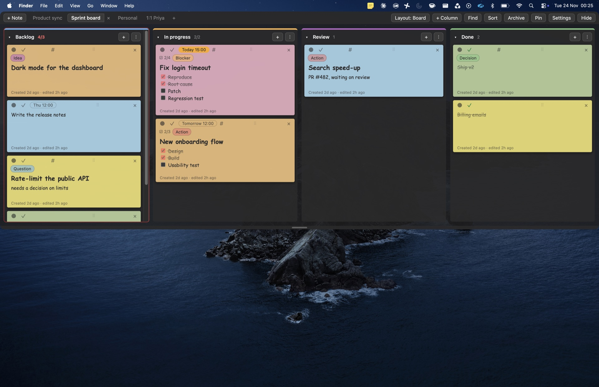
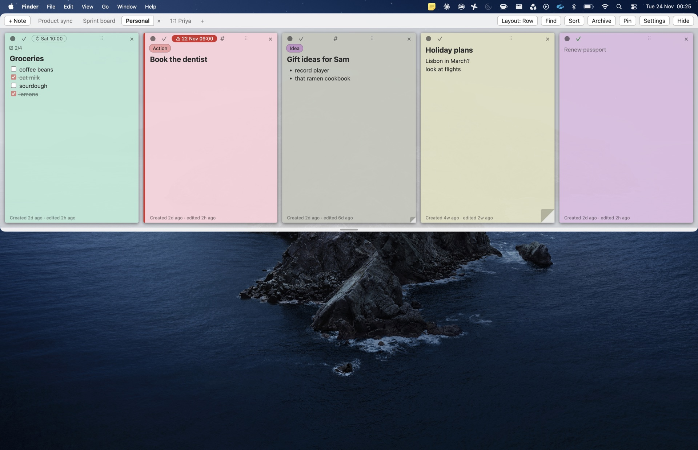
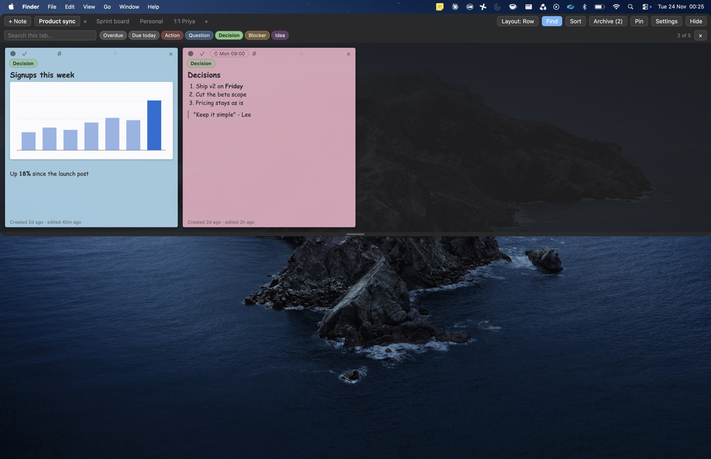
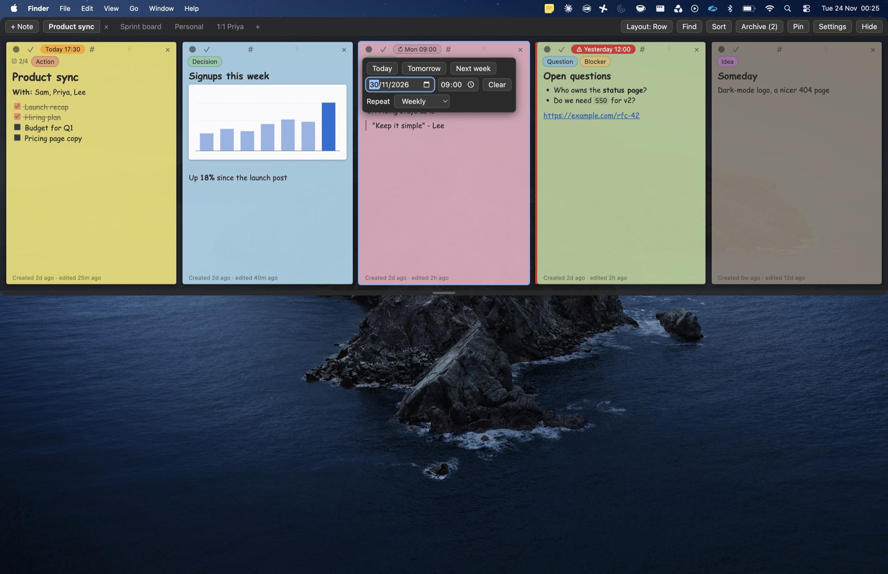
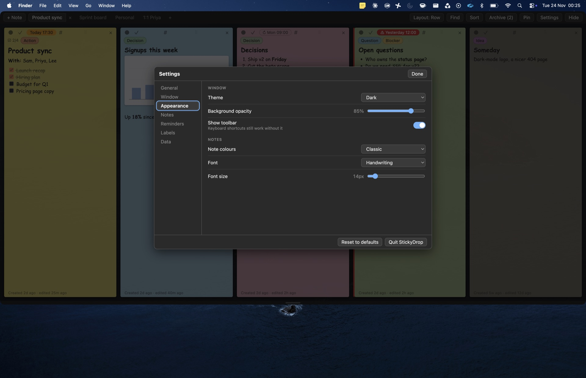

# StickyDrop

**Guake-style drop-down post-it notes** for Ubuntu, macOS and Windows.

Press a key and a row of sticky notes drops from the top of your screen. Jot something down, press `Esc`
(or just click back into your meeting) and it's gone, with no app switching and no lost context. Built for
virtual meetings: quick notes, action items with due dates, and a scratchpad that is always one keypress away.



*One keypress drops your notes over whatever you're doing; another (or `Esc`, or clicking away) puts them away.*

## Contents
- [Features](#features)
- [Screenshots](#screenshots)
- [Install and run](#install-and-run)
- [Using it](#using-it)
- [Settings reference](#settings-reference)
- [Linux on Wayland](#linux-on-wayland-ubuntus-default)
- [Your data](#your-data-and-privacy)
- [Platform status](#platform-status)
- [Development](#development)
- [Known limitations](#known-limitations)

## Features

**Drop-down behaviour (the Guake part)**
- Global hotkey toggles the window: `F9` by default (`Ctrl+Alt+N` on macOS, where F9 is a system key); change it in Settings.
- Opens on the display under your mouse (or the primary / a specific display), full width or any size from 20% of the screen.
- **Drag the grip bar on the window's inner edge** to resize it on the fly (double-click it to reset); the height is remembered.
- Drops from the top or the bottom, aligned left, centre or right, with an optional slide animation.
- Hides when focus is lost, so clicking back into your meeting dismisses it. **Pin** keeps it open.
- If it is open but unfocused, the hotkey *refocuses* it instead of hiding it (as Guake's "refocus" option does).
- Stays on top of other windows (on macOS also above full-screen apps), appears on every workspace, lives in the tray, never in the taskbar.
- Single instance: launching it again just shows the window. `stickydrop --toggle` toggles a running instance, which is how you bind a system shortcut on Wayland.

**Notes**
- Any number of notes in a row; each autosaves as you type. Five colours per palette, four palettes.
- **Markdown**: notes render when you aren't editing them, and clicking one brings the text back.
  Headings, **bold**, *italic*, ~~strikethrough~~, `inline code` and fenced code blocks, nested and numbered lists,
  quotes, rules, links (open in your browser). Task lists (`- [ ]`) render as checkboxes you can tick without entering edit mode.
- **Drag to rearrange**: press and hold any empty part of a note's header (the ⠿ grip marks it; the header shades and the cursor becomes a hand when you're in the right place) and drag. Works in the row and the board layout; `Alt+←/→` does the same from the keyboard.
- **×** archives a note (6-second **undo**); an empty note is simply deleted. There is always at least one note.
- A note with task boxes shows its **checklist progress** in the header ("☑ 2/5", green when all are ticked).

**Due dates and done**
- Optional due date and time per note, with quick picks for Today / Tomorrow / Next week.
- A badge shows the state: **amber** when due today or within 24 hours, **red with a red edge** when overdue.
- A ✓ toggle marks a note done: dimmed and struck through, never flagged overdue. Optionally it moves to the end.
- The tray menu summarises what is overdue or due today ("2 overdue, 1 due today") and lists those notes; clicking one opens it.
- **Repeat** (in the due popover): daily, weekdays, weekly or monthly. Marking a repeating note done moves its due date to
  the next occurrence and unticks its tasks, instead of finishing it (undo is offered). A ↻ in the badge marks it.
- **Reminders**: a desktop notification before a note with a due *time* (at the time, or 5 minutes to 1 hour before;
  Settings → Notes). Clicking it opens the note. Date-only due dates don't notify. Reminders only fire while
  StickyDrop is running (it lives in the tray), and each due date reminds once.

**Organising**
- **Tabs**: separate sets of notes, e.g. "Personal" and one per meeting, each with its own Kanban columns. **+** in the
  toolbar adds one, double-click a tab to rename it, **×** on the active tab deletes it and its notes (with undo).
  `Ctrl/Cmd+1`…`9` switch tabs. Drop a dragged note on a tab to move it there.
- **Labels**: named, coloured tags shared by all tabs (Action, Question, Decision...). A note's **#** button ticks labels
  or creates a new one; they show as chips on the note. Rename, recolour or delete them in Settings → Labels.
- **Find** (`Ctrl/Cmd+F`): search the active tab's text and label names, with quick filters for *Overdue*, *Due today*
  and each label (click a label chip on a note to filter by it). `Esc` clears the filter.
- **Sort**: rearranges the active tab once by due date, recently edited, oldest first, colour or label (within each
  column on the board), with undo. Drag afterwards to adjust.
- **Archive**: archived notes are kept per tab. **Archive** in the toolbar lists them to restore, or delete for good
  (two clicks), or empty the whole archive.

**Kanban board (optional)**
- **Layout** in the toolbar switches the active tab between a row of notes and Kanban columns; each tab keeps its own choice (say, Personal as a row and Work as a board). It is the same notes, so you can switch back and forth freely. Settings → Notes → **Default layout** (a plain row unless you change it) applies to new tabs and to tabs you haven't switched.
- Starts with *To do / Doing / Done*. Click a column name to rename it, **+ Column** in the toolbar adds one (up to 8), **×** deletes one (its notes move to the first column), **+** adds a note to that column.
- Drag a note by its header (any empty part of it) to move it between or within columns (hold it near an edge to scroll to an off-screen column or further down a long one), or use `Alt+←/→` (change column) and `Alt+↑/↓` (reorder) on the focused note.
- Each column's **⋮** menu sets a colour, an optional note limit (a soft warning: the count turns red, nothing is blocked) and delete. **▾** collapses a column to a thin strip. Drag a column header to reorder columns.
- Moving a note into the done column marks it done, moving it out clears that; the ✓ button does the same move. Moving is not an edit, so it doesn't reset aging.

**Images, export and sync**
- **Images**: paste a screenshot (`Ctrl/Cmd+V` while editing) or drop image files onto a note. PNG, JPEG, GIF and WebP up
  to 15 MB are stored next to your notes and linked in the text as ``; click one to open it in your
  image viewer. Markdown image links to `https://` web images show too. Images no note uses any more are cleaned up
  after a week.
- **Right-click a note** (its header or rendered text): *Copy as Markdown*, *Export as Markdown file…*, *Move to tab*,
  *Archive*.
- **Settings → Data**:
  - *Export*: every tab as a Markdown file (board tabs grouped by column, archived notes at the end, images copied
    alongside), or a full JSON backup.
  - *Import*: Markdown or text files (each becomes a note in the current tab), or *Restore a backup* (two clicks), which
    replaces notes, tabs and labels and first saves the current ones as `data.json.before-restore-<time>`.
  - *Sync folder*: keep your notes in a folder that Dropbox, Syncthing, iCloud Drive or similar syncs, and choose the
    same folder on each computer. Notes, tabs, labels and images sync; settings, the active tab and reminders stay per
    computer. Changes made on another computer show up within a second or two, merged note by note with yours: both
    sides' changes are kept, and if the same note was edited on both, the newer edit wins. If the folder already holds
    notes when you choose it, you pick whose to keep.

**Aging**
- Notes visually age with the time since their *last edit*: **Fade** (the paper washes out) or **Vintage**
  (it yellows and a corner curls). Editing a note, ticking a task or changing its due date rejuvenates it.
- You choose how many days until fully aged (1–60). Overdue is a separate signal: its badge and edge never fade.
- Every note shows "Created 3d ago · edited 2h ago" (exact times on hover); this can be turned off.

**Customisation** (Settings, `Ctrl/Cmd+,`: tabs for General, Window, Appearance, Notes, Reminders, Labels and Data)
- Dark, light or follow-system theme; background opacity; four note palettes; four fonts and a size slider; hide the toolbar.
- Window width, height, horizontal position and drop direction; which display; stay-on-top; tray icon; launch at login.
- **Reset to defaults** (two clicks to confirm) restores every setting; notes, tabs and labels are kept.

## Screenshots



*The "Product sync" tab (dark theme, 85% opacity, so the desktop shows through): a meeting note with a label,
checklist progress and a due time, a pasted chart, a decision note that repeats weekly (↻), an overdue question with
two labels, and an old idea fading with age. Four tabs along the toolbar; two notes in the archive.*



*The "Sprint board" tab as a Kanban board: coloured columns, soft note limits (Backlog is over its 3), checklist
progress, due badges, labels and done cards. Each tab keeps its own layout.*

| | |
|---|---|
|  |  |
| **Light theme, Pastel palette, Vintage aging** (the "Personal" tab). Old notes yellow and curl; overdue stays red. | **Find** (`Ctrl/Cmd+F`): text search and quick filters, here the *Decision* label (2 of 5 notes). |
|  |  |
| **Due popover**: quick picks, an exact date and time, and **Repeat**. | **Settings**: General, Window, Appearance, Notes, Reminders, Labels and Data tabs. Changes apply live. |

(Screenshots and the animation are regenerated from sample data with `just screenshots`; on macOS they show the
whole desktop, with every other app's windows left out.)

## Install and run

**Download:** grab the `.deb`, `.AppImage` (Linux), `.dmg` (macOS) or `.exe` (Windows) from the
[Releases page](https://github.com/karlbaillie/stickydrop/releases). Builds are unsigned (see below). Snap Store: `sudo snap install stickydrop` once published (see [RELEASING.md](RELEASING.md)).

**Requirements:** macOS 12 (Monterey) or later on Apple Silicon, Windows 10 or later, or a 64-bit Linux desktop
(built on Electron 45).

**From source:** needs Node.js 22.12 or later and npm (developed on Node 24). There are no runtime dependencies: Electron is bundled into the packaged app.

```bash
npm install
npm start            # run from source
```

Build installers for the OS you are on (output in `dist/`):

```bash
npm run dist         # Linux: .deb and .AppImage · macOS: .dmg · Windows: NSIS installer
sudo apt install ./dist/stickydrop_0.1.0_amd64.deb   # Ubuntu/Debian; the post-install step adds a `stickydrop` command
```

Notes:
- `npm start` passes `--no-sandbox` because Electron's sandbox helper isn't set up for a source checkout on recent
  Ubuntu. The `.deb` installs the helper properly; the AppImage disables the sandbox itself.
- If `npm install` finishes but Electron says it "failed to install correctly", run `node node_modules/electron/install.js`
  (or delete `node_modules/electron` and reinstall).
- `.github/workflows/build.yml` builds all three platforms on GitHub runners. Builds are not notarised or
  code-signed with a paid certificate. **macOS** (ad-hoc signed): the first launch is blocked; open System Settings →
  Privacy & Security → "Open Anyway", or run `xattr -dr com.apple.quarantine /Applications/StickyDrop.app`.
  The release build is arm64 (Apple Silicon) only for now. **Windows**: SmartScreen shows "More info → Run anyway".

## Using it

| Key | Action |
|---|---|
| `F9` (macOS `Ctrl+Alt+N`) | Show / hide / refocus the window (configurable) |
| `Ctrl/Cmd+N` | New note |
| `Ctrl/Cmd+,` | Settings |
| `Ctrl/Cmd+F` | Find: search and filter the active tab |
| `Ctrl/Cmd+1`…`9` | Switch to tab 1–9 |
| `Esc` | Close what is open (settings, a popover, the archive, the filter), otherwise hide the window |
| `Alt+←/→` / `Alt+↑/↓` | Move the focused note: row layout, earlier / later; board layout, to another column / up or down |
| `Tab` | Move between notes and their controls |
| Click a rendered note | Edit it; it re-renders when focus leaves |

Each note's header has: a colour button (●), a done toggle (✓), a due badge, labels (#), checklist progress and
archive (×). The toolbar has **+ Note**, the tabs, **Layout** (this tab's row/board), **Find**, **Sort**, **Archive**, **Pin**, **Settings** and **Hide**. Right-click the tray icon for show/hide, the due summary and Quit.
Closing the window (Alt+F4) only hides it; quit from the tray menu or Settings.

Command line:

```bash
stickydrop --toggle    # show/hide the running instance (starts it if needed)
stickydrop             # a second launch simply shows the window
```

## Settings reference

| Tab | Setting | Default | Notes |
|---|---|---|---|
| General | Show / hide shortcut | `F9` / `Ctrl+Alt+N` (macOS) | Click and press the new combination; plain letters are rejected |
| General | Refocus instead of hiding | on | When the window is open but unfocused, the shortcut brings it forward |
| General | Hide when focus is lost | on | Pin overrides it for the session |
| General | Stay on top of other windows | on | |
| General | Show tray icon | on | |
| General | Launch at login | off | Linux: `~/.config/autostart`; macOS/Windows: login items |
| Window | Show on | Display under the mouse | Or primary display, or a specific one |
| Window | Drops from | Top | Top or bottom |
| Window | Horizontal position | Center | Left, center or right (when narrower than 100%) |
| Window | Width / Height | 100% / 40% | 20–100% / 15–100% of the display's work area; height is also set by dragging the window edge |
| Window | Slide in and out | on | |
| Appearance | Theme | Follow system | Dark, light, or follow system |
| Appearance | Background opacity | 85% | 30–100% |
| Appearance | Show toolbar | on | Keyboard shortcuts still work when hidden |
| Appearance | Note colours | Classic | Classic, Pastel, Earth, Mono |
| Appearance | Font / Font size | Handwriting / 14 px | Handwriting, sans, serif, monospace; 12–32 px |
| Notes | Default layout | Row of notes | For new tabs and tabs without their own; the toolbar's **Layout** button sets a tab's. Columns, colours and limits are kept in your data, not reset |
| Notes | Minimum note width | 300 px | 200–600; row layout: notes never squeeze narrower, the row scrolls instead |
| Notes | Maximum note width | 420 px | 260–800; the most a note stretches in the row layout (never below the minimum) |
| Notes | Move done notes to the end | off | Row layout |
| Notes | Render Markdown | on | Off = plain text boxes |
| Notes | Show created and edited times | on | |
| Notes | Aging / Fully aged after | Fade / 14 days | Off, Fade or Vintage; 1–60 days |
| Reminders | Desktop reminders | on | Only for due dates with a time, while StickyDrop runs |
| Reminders | Remind me | 10 minutes before | At the due time, or 5, 10, 15, 30 or 60 minutes before |
| Labels | (your labels) | none | Add, rename, recolour or delete; deleting removes the label from every note |

## Linux on Wayland (Ubuntu's default)

The app runs under XWayland so it can position itself and stay on top. But Wayland only delivers global-hotkey
key presses to an X11 app while an X11 window has focus, so the built-in hotkey is unreliable there. (Guake has
the same limitation; its documented workaround is the same.) The fix is a **system shortcut** that runs
`stickydrop --toggle`.

GNOME: Settings → Keyboard → Keyboard Shortcuts → Custom Shortcuts → add `stickydrop --toggle` with the key you
want. Or from a terminal (note this replaces any custom shortcuts you already have, so add to the list instead if you do):

```bash
P=/org/gnome/settings-daemon/plugins/media-keys/custom-keybindings/stickydrop/
S=org.gnome.settings-daemon.plugins.media-keys.custom-keybinding:$P
gsettings set $S name 'StickyDrop'
gsettings set $S command 'stickydrop --toggle'      # or the full path to the AppImage / electron + project dir
gsettings set $S binding 'F9'
gsettings set org.gnome.settings-daemon.plugins.media-keys custom-keybindings "['$P']"
```

Starting the command also launches the app if it isn't running, so the shortcut works from a cold start.

## Your data and privacy

- Everything is stored locally in one JSON file: `~/.config/stickydrop/data.json` (Linux),
  `~/Library/Application Support/stickydrop/data.json` (macOS), `%APPDATA%\stickydrop\data.json` (Windows),
  with images in an `attachments` folder beside it. It is plain, unencrypted text.
- With a **sync folder** set, the notes part (notes, tabs, labels) and the images are written there as well, and that
  folder's copy is what loads at startup; the local file keeps settings and a full copy of the notes. If the folder is
  missing at startup the local copy is used and nothing is written to the folder until the next start.
- **Settings → Data** exports Markdown or a JSON backup and restores backups (Open shows the data folder).
- Writes are atomic (temp file, then rename). If the file ever can't be parsed, it is moved aside as
  `data.json.corrupt-<time>` and never overwritten.
- No accounts, telemetry or updates. The only network access is a web image you put in a note (``),
  loaded without a referrer when the note shows. Links in notes open only on click, only `http(s)`, in your browser.
- The window runs with context isolation, no Node integration and a content-security policy of `default-src 'self'`,
  plus images from `https:` and the app's own `sdimg:` scheme (which serves only files from the attachments folder).
  The Markdown renderer builds elements from text and never uses `innerHTML`, so a pasted `<script>` or ``
  is shown as plain text.

```json
{
  "settings": { "hotkey": "F9", "theme": "dark", "heightPct": 40, "...": "..." },
  "tabs": [{ "id": "main", "name": "Notes", "layout": "board",
    "columns": [{ "id": "todo", "name": "To do", "color": 4, "limit": 3 }, { "id": "done", "name": "Done", "done": true }] }],
  "activeTab": "main",
  "syncDir": "/Users/me/Dropbox/StickyDrop",
  "labels": [{ "id": "q1w2e3r4", "name": "Action", "color": 0 }],
  "notes": [
    { "id": "k3j9x2ab", "text": "# Standup\n- [ ] send notes", "color": 0, "tab": "main", "col": "todo",
      "created": 1731571200000, "updated": 1731574800000, "due": "2026-11-14T17:00", "repeat": "weekly",
      "done": false, "labels": ["q1w2e3r4"] },
    { "id": "z9y8x7w6", "text": "old idea", "color": 2, "tab": "main", "archived": 1731600000000, "...": "..." }
  ],
  "reminded": { "k3j9x2ab": "2026-11-14T17:00" }
}
```

## Platform status

| Platform | Status |
|---|---|
| Ubuntu 24.04+ on GNOME/Wayland (via XWayland) | **Developed and tested here**: end-to-end suite, packaging (`.deb`, AppImage), hotkey via `--toggle` |
| Linux on an X11 session | Expected to work, including the built-in global hotkey; not tested |
| macOS 26 (Apple Silicon) | **Tested**: end-to-end suite (locally and on CI), plus by hand: drag-and-drop in both layouts with Stay on top, showing over full-screen apps |
| Windows | **End-to-end suite passes on CI**; not tried by hand |

## Development

```
main.js          main process: window, tray, hotkey, settings schema + validation, persistence
preload.js       the small, explicit bridge between window and main
index.html       page shell · style.css: all styling, theming and aging effects
renderer.js      notes UI, due popover, settings form (generated from the schema main sends)
markdown.js      small safe Markdown → DOM renderer
timeutil.js      pure date / due / age / tray-summary / checklist / recurrence / reminder helpers
exporter.js      pure Markdown-export and attachment helpers (main)
sync.js          pure three-way merge for the sync folder (main)
test/            time.test.js, export.test.js, sync.test.js (unit) · e2e.js (drives the real app with Playwright)
scripts/         screenshots.js (regenerates docs/: screenshots and drop.gif) · capture.swift (macOS screen capture)
```

All tasks are `just` recipes (`just` lists them); CI runs the same ones.

```bash
just test          # unit tests, then the end-to-end suite
just screenshots   # refresh the README screenshots (macOS: full-desktop shots)
just dist          # build installers for this OS
```

- The end-to-end suite launches the real app against a temporary data directory (`STICKYDROP_DATA`), so it never
  touches your notes. It needs a display, and it needs `F9` to be free: **quit a running StickyDrop first.**
- It covers notes, undo, Markdown and checkbox toggling, links and images (paste, drop, web), due dates, repeats,
  reminders, done, aging, drag-and-drop and auto-scroll in both layouts, the Kanban board, tabs, labels, find, sort,
  archive, every settings tab (including bad-value clamping, reset and the one-time default migrations), window
  placement and resizing, `--toggle`, refocus, export / import / restore, the sync folder (including a change arriving
  while you type), persistence across restarts and corrupt-file recovery.
- Adding a setting is one entry in `SCHEMA` in `main.js`; the settings form, validation, defaults and reset pick it up.

## Known limitations

- **Opacity below 100%** (85% by default) blends with the desktop on macOS. On Linux and Windows it relies on the
  compositor honouring a transparent window; without one the background shows solid.
- **Wayland**: the in-app global hotkey is unreliable; use the `--toggle` system shortcut (above).
- **Touch screens**: dragging uses native drag-and-drop, which desktop Chromium doesn't support by touch; use `Alt+arrow` keys.
- **Markdown** has no tables or raw HTML (HTML is shown as text).
- **Reminders** only fire while StickyDrop is running, and a reminder more than a day late is skipped.
- **Sync** merges whole notes, not lines: the same note edited on two computers keeps only the newer edit. Tabs and
  labels changed on both computers at once keep this computer's version.

## License

MIT, see [LICENSE](LICENSE).
